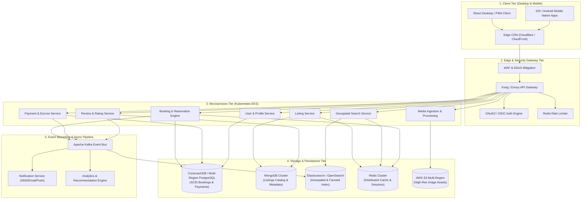

# Production-Scale Vacation-Rental Marketplace Architecture

This document presents the system architecture for a production-scale vacation rental marketplace (such as Airbnb). The design accounts for high throughput, low-latency geospatial search, global media delivery, financial transaction safety, high availability, and horizontal scalability.

---

## 1. System Architecture Diagram

---

## 2. Component Architecture Breakdown

### 2.1 Frontend & Media Delivery
* **Stack**: React 18, TypeScript, Vite, CSS Design System, Web Vitals Optimization.
* **CDN Caching**: Edge CDN (Cloudflare Enterprise / AWS CloudFront) caches static JavaScript/CSS assets, image thumbnails, and HTTP response headers.
* **Image Optimization Pipeline**: Uploaded photos are ingested via direct-to-S3 presigned URLs, processed by an AWS Lambda worker (sharp image pipeline) into NextGEN WebP/AVIF formats at multiple resolutions (`thumbnail`, `hero`, `lightbox_hd`), and served globally.

### 2.2 API Gateway & Security Tier
* **Routing & Load Balancing**: Envoy Proxy / Kong API Gateway routes traffic, handles TLS termination, CORS policy enforcement, and request header transformation.
* **Auth**: JWT tokens issued via OAuth2 / OIDC authentication service with refresh token rotation.
* **Rate Limiting**: Sliding window algorithm implemented in Redis Cluster to prevent scraping and brute-force reservation locks.

### 2.3 Microservices Layer
* **Listing Service**: Manages property listing CRUD operations, amenity tagging, and house rules.
* **Search & Discovery Service**: Powers instant location filtering, price range sliders, date availability constraints, and spatial radius search.
* **Booking & Reservation Engine**: Handles check-in/check-out date validation, double-booking prevention using distributed lock primitives, and reservation state machines.
* **Payment & Escrow Service**: Integrates with Stripe / Razorpay for multi-currency payment collection and host payout scheduling after check-in.

### 2.4 Data & Storage Architecture
| Data Store | Purpose & Pattern |
|---|---|
| **CockroachDB / PostgreSQL** | Multi-region ACID database for financial transactions, bookings, and user authentication tables. |
| **MongoDB Cluster** | Document storage for listing metadata, flexible amenities schemas, and host profiles. |
| **Elasticsearch / OpenSearch** | Spatial Geo-Point indexing (`location: { lat, lon }`), full-text search, and multi-faceted filtering. |
| **Redis Cluster** | In-memory distributed caching for listing availability calendars, high-traffic listing details, and rate limiting. |
| **AWS S3 Bucket** | Multi-region object storage for gallery photos and user verification documents. |

### 2.5 Event-Driven Messaging & Async Processing
* **Apache Kafka**: High-throughput message broker capturing real-time events (`booking.created`, `booking.confirmed`, `review.submitted`, `price.updated`).
* **Search Indexing Worker**: Listens to Kafka topics to sync MongoDB listing updates into Elasticsearch in real time (< 50ms propagation).
* **Notification System**: Triggers instant booking emails, SMS OTPs, and mobile push notifications.

---

## 3. Deployment, Reliability & Scaling

* **Containerization & Orchestration**: Kubernetes (AWS EKS / GCP GKE) running HPA (Horizontal Pod Autoscaler) based on CPU/RAM and custom Prometheus request metrics.
* **Multi-Region Availability**: Active-Active multi-region deployment across US, Europe, and Asia-Pacific.
* **Disaster Recovery**: Automated database point-in-time recovery (PITR) with RPO < 1 minute and RTO < 5 minutes.
